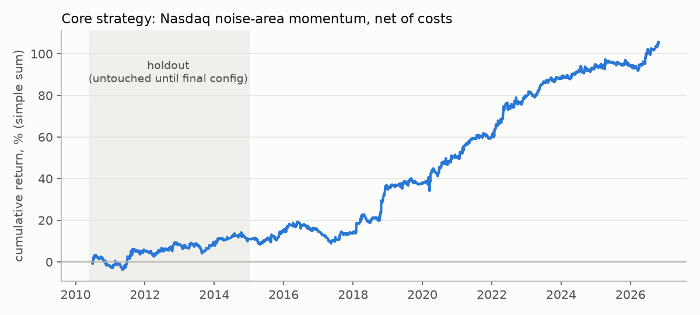
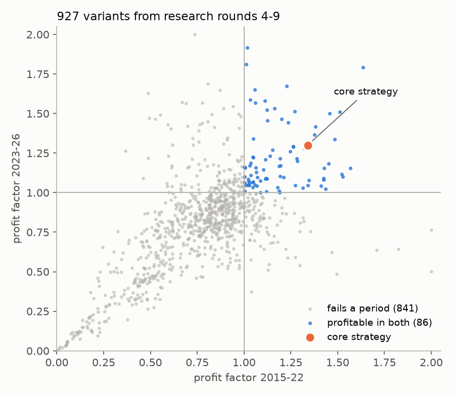

# Futures Strategy Research

An independent research project testing whether published intraday trading strategies still work on CME futures once realistic trading costs are included.

**Short answer:** For the most part, no. Of ~1,300 variants built from ~40 academic papers, nearly all failed after costs or didn't hold up across all test periods. One Nasdaq intraday-momentum strategy held up in every test period, including a holdout period, tested after the strategy showed consistency across other test periods. Additionally, one Russell 2000 mean-reversion strategy held up with low correlation to the other, effectively diversifying the backtest portfolio.  

> All results are backtests, net of estimated costs. Nothing here is live performance or investment advice.



---

## Key findings

| | Result |
|---|---|
| Data | ~29.5M rows of 1-minute bars, 8 CME futures markets, 2010–2026 |
| Strategies tested | ~40 papers → ~1,300 variants over 9 research rounds |
| Survived all checks | Nasdaq "noise area" intraday momentum (Zarattini, Aziz & Barbon, 2024) with three filters |
| Its results | Profit factor **1.11 / 1.34 / 1.30** in 2010–14 (holdout) / 2015–22 / 2023–26, ~0.7 trades/day |
| Diversifier | Russell 2000 RSI fade on 15-min bars: positive in both halves for 89 of 162 parameter settings, correlation −0.13 with the core strategy |
| Main reason ideas failed | A realistic 4-tick round-trip cost is larger than the edge of most sub-hour strategies |

Only 86 of 927 variants from the later research rounds were profitable in both 2015–22 and 2023–26 — and with that many tests, some of those are luck. That is why every survivor was re-tested with parameter sweeps and the untouched holdout.



---

## Data

- **Source:** Databento CME 1-minute OHLCV, continuous front-month contracts.
- **Markets Tested:** Nasdaq-100 (NQ), S&P 500 (ES), Dow (YM), Russell 2000 (RTY), gold (MGC), crude oil (CL), 10-year note (ZN), euro FX (6E).
- **Periods:** NQ 2010–2026; others 2015–2026 (crude from late 2022).
- **Cleaning:** one regular-session grid per day; half days dropped; days with a contract change excluded from anything that uses the previous close; one truncated download was recovered and stitched.
- Raw data is **not included** (licence). `src/download_databento.py` re-downloads it with your own API key and prints the cost before buying anything.

## Method

1. **Rebuild each paper's rule simply**, then run it as a grid across all 8 markets.
2. **Costs:** 4 ticks per round trip on every trade (e.g., 1 index point on NQ). Results in basis points of notional so markets are comparable.
3. **Two independent halves:** 2015–22 and 2023–26; a strategy must be profitable in both.
4. **Holdout:** NQ 2010–14 was downloaded only after a strategy proved consistent across 2015-2026, and used once.
5. **Overfitting checks:** parameter-stability sweeps (plateau or spike?), train→test rank correlation across all configurations (an early filter family scored −0.49 and was rejected; the RSI fade scored 0.64), cost stress at 2/4/6/8 ticks, and control groups.
6. **Multiple testing:** with ~1,300 variants, some pass by chance — anything that passed was re-tested before being accepted.

## The core strategy (plain English)

Each day, measure how far Nasdaq futures normally move away from the open by each time of day (14-day average). That defines a "noise band" around the open. Every 30 minutes between 10:00 and 15:30 ET, if price closes outside the band in the same direction as the overnight gap, enter in that direction. Exit at 3× the noise distance (target), 0.5× (stop), when price falls back inside the band, or at the close.

An extra filter found: skip the day after an unusually large move, based on Daniel & Moskowitz's "momentum crashes" (2016) this improved it slightly (profit factor 1.13 / 1.38 / 1.37).

## What didn't work (selection)

| Idea | Source | Result |
|---|---|---|
| Last-30-minute momentum | Gao et al. 2018; Baltussen et al. 2021 | Reverses on futures; lost in every market |
| VWAP trend, VWAP fades, anchored VWAPs | Zarattini & Aziz 2023; practitioner rules | Only NQ variants pass, and they duplicate the core strategy (correlation ~0.5) |
| Opening-range breakout | Zarattini & Aziz 2023 | Positive on NQ in some periods only; fails the holdout |
| Order flow, jumps, lead-lag, round numbers (20 high-frequency ideas) | various | 0 of 20 survive 4-tick costs |
| Overnight long | various | Positive, but it is market exposure — loses heavily in 2022; rejected |
| The core strategy on ES, gold, crude, Russell, Dow, bonds, euro | — | Fails; the effect is Nasdaq-specific |

## Evaluation-account simulation

A side analysis modelled futures "prop-firm evaluation" accounts (reach a profit target before hitting a loss limit). Replaying real history from every possible start day gave short-horizon pass rates about 5 percentage points lower than the common shortcut of sampling random days, because losing days cluster.

## Limitations

- Backtests only; no live track record yet.
- Some filters were chosen on 2015–26 data; the 2010–14 holdout is the most realistic estimate (weaker with a profit factor of ~1.1).
- Minute bars cannot show exact fills inside a bar; stops are assumed filled at the stop price or worse.
- Published anomalies often weaken after publication; the core strategy's paper is from 2024.

## How this was built

I used Claude to scan the internet for research papers and report back with findings. I would then sort through the research papers, picking out the ones that seemed the most promising. I would then have Claude back test across 3 different periods, 2015-2022, 2023-2026, and 2010-2014. 2010-2014 wasn't initially included in the back test periods, but after finding out the noise strategy was profitable across 2015-22 and 2023-2026, I decided to run an additional back test to further confirm it held up. I then sorted through each strategies results, mainly looking for smooth equity curves, decent trade counts (at least 0.3 per day), and consistency across periods. One strategy in particular, centered around a long position during the overnight hours, looked profitable (1.5 PF), but I chose not to include it because I believe in a bear trend it would crumble. By the end, I had the noise strategy on NQ and the RSI-fade strategy on RTY. Ideally, I wanted to have a GC or CL algorithm as well, but I found it hard to build something that was profitable across both periods, which I theorize is due to a regime change around 2023.

## Repository layout

```
src/
  config.py               data folder (FSR_DATA_DIR, default ./data)
  download_databento.py   data download (cost estimate first)
  lit_futures_grid.py     daily minute-grid loader + first literature grid
  noise_filters_nq.py     core strategy and its filters
  noise_walk_forward.py   filter selection on 2015-22 vs 2023-26
  noise_oos_2015.py       out-of-sample check on 2015-22
  holdout_eval.py         2010-14 holdout + realistic evaluation simulations
  research4/8/9.py        example research rounds (new families, multi-hour rules, VWAP)
  validate_r6_r9.py       RSI-fade parameter sweep
  validate_vwap.py        VWAP candidate sweep + portfolio test
  firm_compare_sim.py     evaluation-account rules and simulation
  make_figures.py         the two charts above
results/                  CSV output of the research rounds and validations
figures/                  README charts
```

## Reproduce

```
pip install -r requirements.txt
export DATABENTO_API_KEY=...                      # your own key
cd src
python download_databento.py NQ --start 2015-01-01 # prints the cost; add --download to buy
python noise_walk_forward.py
python holdout_eval.py
python make_figures.py
```

---
Dylan Bryant · Business Analytics, Western Washington University · https://www.linkedin.com/in/dylanbryant28/
